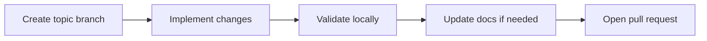

# Contributing to AimBuddy

Thanks for contributing. This project includes performance-sensitive Android and C++ runtime paths, so review quality is more important than change volume.

## Contribution Principles

- Fix root causes, not symptoms.
- Keep pull requests focused on one objective.
- Preserve behavior unless the change scope explicitly includes behavior updates.
- Prefer simple and maintainable implementations.

## Development Workflow



1. Create a topic branch from `master`.
2. Implement with minimal unrelated edits.
3. Validate locally (build + on-device test).
4. Update docs when behavior, architecture, settings, or workflow changed.
5. Open a pull request with clear evidence of validation.

## Required Validation

### Build and tests

Run before opening a pull request:

```powershell
./gradlew.bat clean assembleDebug testDebugUnitTest
```

The C++ core (tracker, aim controller, camera motion, touch merger, decoder, settings) has its own tests that need no phone, only a C++17 compiler:

```sh
sh app/src/test/native/run.sh
```

Changes to that code should come with a test.

### Runtime Validation

If your change affects detection, tracking, or aim control:

1. Install the debug APK on a test device.
2. Verify basic detection works (enemies detected and boxes drawn).
3. Verify aim assist tracks and releases correctly (with Shizuku or root).
4. Check logcat for errors or warnings.

### Training Pipeline

If your change touches training or export:

1. Run the affected scripts in `training/scripts/`.
2. Include output summary and report paths in your PR.

## Code Standards

- No placeholder implementations, dead code, or commented-out blocks.
- Keep naming consistent with existing module conventions.
- Keep hot paths efficient: no allocations, no locks, no logging in per-frame loops.
- Avoid unrelated formatting-only churn.
- Do not mix broad refactors with behavior changes in the same pull request.

### Hot Path Rules

These paths run every frame. Extra care is required:

| Path | File | Rules |
|------|------|-------|
| Detection loop | `pipeline/detection_pipeline.cpp`, `detector/yolo_detector.cpp` | No allocs, no locks, pre-allocated buffers only |
| Tracker | `core/tracker.cpp` | Fixed-size arrays, no heap, no logging |
| Aim controller | `core/aim_controller.cpp` | Snapshot settings, no blocking, bounded math |
| Overlay render | `renderer/imgui_menu.cpp` | No setting writes during draw, defer saves |

### Settings Safety

- Every value is clamped by `Settings::clamp()` when it is stored, so no other code checks ranges.
- A new setting is a field in `settings/settings.h` with a safe default and a range in `clamp()`, one line in `visitFields` in `settings/settings_store.cpp`, a control in the Settings screen, and a line in `docs/SettingsGuide.md`.
- A setting that moves the aim by itself must not be saved as on.

## Pull Request Content

Include in your PR description:

1. **Problem statement**: What issue or feature this addresses.
2. **Technical approach**: How you solved it and why.
3. **Validation output**: Build log, device test results, logcat output.
4. **Risk and rollback notes**: For behavior changes, explain how to revert.
5. **Scope boundaries**: What this PR intentionally does not change.

## Review Criteria

A pull request can be rejected if it:

- Bundles unrelated changes.
- Lacks local validation evidence.
- Introduces architecture drift without clear justification.
- Reduces maintainability or runtime stability.
- Adds per-frame cost without measured benefit.

## Documentation Standards

- Keep docs clear, direct, and easy to follow.
- Use tables for structured data, mermaid diagrams for flows.
- No em dashes. Use commas, periods, or parentheses instead.
- Keep Android and training commands aligned with current repository behavior.
- Say "aim assist", as the app does.
- Update these files when relevant: `README.md`, `docs/`, and `training/README.md`.

## File Reference

| What to Update | When |
|----------------|------|
| `README.md` | New features, build steps, dependencies |
| `docs/Architecture.md` | Module changes, threading, data flow |
| `docs/SettingsGuide.md` | New settings, default changes |
| `docs/Performance.md` | Optimization changes, new telemetry |
| `docs/Training.md` | Pipeline steps, dataset format, export changes |
| `docs/Troubleshooting.md` | New messages in the app, new known issues, diagnostic steps |
| `docs/ShizukuSetup.md` | Changes to how touch access is started |
| `docs/Releasing.md` | Signing, the release workflow, how updates are found |
| `model/README.md` | The store's format and the rules for adding a model |
| `CHANGELOG.md` | Every change a player or a contributor can notice, under `## [Unreleased]` |

## Licensing

By contributing to this repository, you agree that your contribution is released under the repository license in `LICENSE`.
