<h1 align="center">AimBuddy</h1>

<p align="center">
  On-device computer vision and control for aiming in touchscreen 3D shooters.<br>
  It finds people in the game picture, marks them, and steers the view toward the nearest one with one extra finger.
</p>

<p align="center">
  <a href="https://github.com/1337Xcode/AimBuddy/releases"></a>
  
  <a href="LICENSE"></a>
</p>

<p align="center">
  <a href="#how-it-works">How it works</a> ·
  <a href="#steering-the-camera">Steering the camera</a> ·
  <a href="#target-marks">Target marks</a> ·
  <a href="#detection">Detection</a> ·
  <a href="#touch-helper">Touch helper</a> ·
  <a href="#benchmarks">Benchmarks</a> ·
  <a href="#install">Install</a>
</p>

AimBuddy is built for players with low vision or motor impairments, for whom fast, precise aiming on a touchscreen is the barrier. It reads the game's picture, finds people in it with a neural network (or, as an experiment, by the colour of the outline a game draws round them), draws marks over them, and, once the player switches steering on, drags one extra finger across the screen to turn the camera toward the nearest one. The player's own fingers keep working at the same time.

Everything runs on the phone. The app's only network use is the model store and the update check, both on GitHub. Free and open source.

| | |
|---|---|
| Runs on | Android 11 or newer, arm64 |
| Sees with | An NCNN model on the CPU or through Vulkan, or an experimental colour matcher that needs no model |
| Aims with | A feedback controller that measures the game's camera while it aims |
| Touches with | One extra finger added to the real touchscreen by a helper that Shizuku or root starts |
| Draws with | Dear ImGui in a `TextureView`: corner marks, an aim point, two fields of view, readouts |
| Built from | Kotlin and Jetpack Compose for the app, C++17 for detection, tracking and control |

## What is technically different

| Idea | In short |
|---|---|
| [A controller that learns the camera](#steering-the-camera) | The gain and the delay of the game's camera are fitted from the controller's own moves, so nothing is calibrated by hand |
| [Reading the camera from video](#steering-the-camera) | Phase correlation on a 64 by 64 picture, with the game's fixed interface, AimBuddy's own marks and detected enemies left out |
| [A second finger on a screen Android will not share](#touch-helper) | The helper takes over the real touchscreen and merges it with the extra finger into one virtual copy |
| [Detection on a phone that is running the game](#detection) | The newest frame wins, the GPU is used only when it is clearly faster and gives the CPU's answer, detection eases off when the phone is hot |
| [Marks that stay out of the detector's way](#target-marks) | Corner brackets a little off the target, because the overlay is part of the picture the model reads |
| [An overlay that works under Android's rules](#target-marks) | A `TextureView` window kept under the 0.8 opacity limit, and a streamer mode that draws nothing over the game |
| [Updates it can check](#models-and-updates) | Models and app updates are checked for size, SHA-256, package, version and signing certificate before they are used |

## How it works

AimBuddy is three programs: the app (Kotlin), a native library in the same process (C++), and a touch helper in a process of its own (`libaimtouch.so`, C++) that Shizuku or root starts. The map below shows where each piece lives and what flows between them.

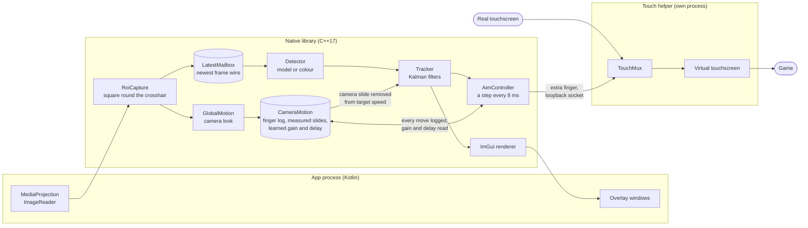

One frame, from the screen to the finger and to the overlay:

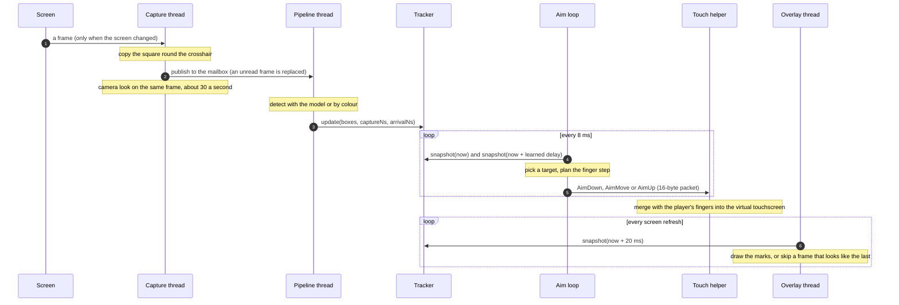

Three rules keep the delay short. The newest frame wins: a slow phone drops frames and a result is never older than one detection. The camera look runs after the frame has been published, so the detector never waits for it. And every step plans through the delay it knows about: the aim controller aims where the target will be when its move takes effect, and the overlay draws 20 ms ahead.

<details>
<summary>Classes and who owns what</summary>

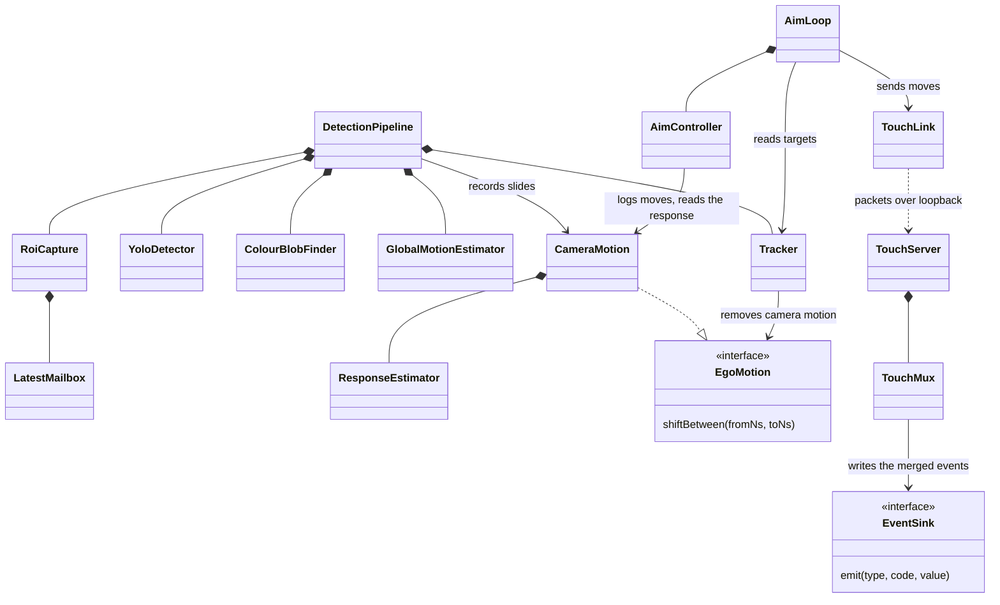

Everything under `core/` takes the time as an argument and makes no file, socket or Android calls, so the tracker, the aim controller, the camera estimators, the colour finder and the touch merger run in tests on a computer, against a simulated game, at any speed. [docs/Architecture.md](docs/Architecture.md) follows each step through the code, and lists the threads.

</details>

## Steering the camera

How far a game's view turns for each pixel of finger movement (the gain) differs between games and sensitivity settings by a factor of ten or more, and the game shows the turn a frame or two late (the delay). A controller that guesses either figure wrong overshoots and circles the target, or crawls. AimBuddy asks the player for neither. The controller records every move it makes, a second stage measures how the whole picture slid, and a fit of the one against the other gives the gain and the delay. Ordinary aiming is the experiment.

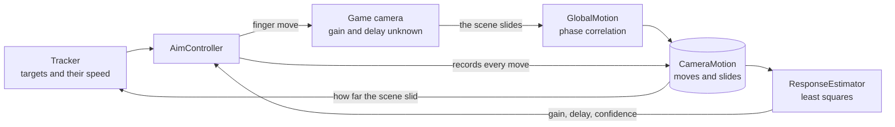

Every 8 ms the controller does four things:

1. It plans through the delay. A move shows up on screen one or two frames later, so judging by the screen as it is now would order the same correction again and again. The controller asks the tracker where each target will be at now plus the learned delay, with the camera slide that earlier moves have already promised included, and aims there.
2. It leads a moving target. The tracker's speed estimate has the camera's own movement taken out. A target running at speed `v` needs the scene to slide at `v` too, so the finger keeps moving at `v / gain` even when the error is zero. The lead fades in as the speed rises above its own uncertainty, and fades out while the camera cannot be read.
3. It closes the gap and does not chase it. Each step removes a fraction of the remaining error, `1 - exp(-dt / tau)`, with `tau` from 200 ms at strength 0 down to 25 ms at strength 1, under a finger speed limit and with a dead zone round the aim point so detector noise does not make the finger twitch.
4. It is careful while the camera is unknown. Until the gain is pinned down, only `8 + 300 * confidence^3` pixels of finger travel may be on their way at once, so the first move is small and its effect teaches the real gain. If the aim swings anyway (three zero crossings within 0.7 s), a stability factor takes the strength down by 40% each time, to a floor of 20%, and gives it back once the aim has been calm for half a second.

How the finger behaves over time, including the cases where the game or the detector misleads it. The waits and the times are in the dropdowns below.

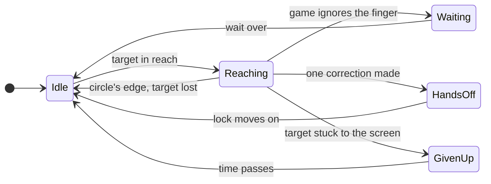

<details>
<summary>How the gain and delay are fitted</summary>

`ResponseEstimator` keeps, for each axis and for each of 25 candidate delays (0 to 192 ms in steps of 8 ms), three running sums that fade over about a second:

```text
Sxf(d) = sum of slide * finger(d)       Sff(d) = sum of finger(d)^2       Sss = sum of slide^2

finger(d)  the finger travel that landed in the slide's window if the game takes d to answer
gain(d)    = -Sxf(d) / Sff(d)           the scene slides the opposite way to the finger
miss(d)    = Sss - Sxf(d)^2 / Sff(d)    what a straight line through the points leaves unexplained
delay      = the d with the smallest miss, refined by a parabola through its two neighbours
```

A delay is believed only when the fits two steps either side of the best one are worse by at least nine times the variance that the best fit leaves unexplained. The confidence is `1 / (1 + (s / 0.2)^2)` times `min(1, n / 4)`, where `s` is the standard error of the gain as a share of the gain and `n` the number of measurements behind it. The estimate is used from a confidence of 0.3, and until then the controller plans with its starting guess and the small-moves rule.

When the player turns the camera too, the extra finger mostly reacts to that turning, and a straight fit of slide on finger travel misses both figures. A second set of sums uses how each slide differs from the one before against how the finger travel differs, which drops a smooth turn out. The estimate comes from whichever set pins the gain down better. What was learned is saved and used as a first guess in the next run, never as a fact.

</details>

<details>
<summary>How the camera is read from video</summary>

`GlobalMotion` reduces both frames to 64 by 64 grey values, fades their borders, transforms them with a two-dimensional FFT and normalises the cross-power spectrum, so the overall brightness drops out. The inverse transform has its peak at the shift, and the method copes with shifts up to half the frame and needs no features. Three things make it work on game footage:

- Parts of the picture that do not move with the camera (the game's buttons and crosshair, the weapon, AimBuddy's own marks) would pull the answer toward zero. Whenever the picture as a whole clearly moves, the pixels that stayed the same are counted, and the ones counted often enough are left out of later looks.
- Detected enemies are handed over as boxes and left out of the frame and of the one before it. A large enemy crossing the middle of the view would otherwise be taken for the camera turning.
- The three strongest peaks are each polished by a few least-squares steps, and the one that explains the largest share of the picture wins. If even that explains too little, what it left unexplained is searched again.

The result carries a quality from 0 to 1. A picture without edges earns none, because a bare sky looks the same however far it slid, and the controller counts the share of the last second that could not be read as blindness and takes less finger travel while it is high. A look is made on about 30 frames a second at most.

</details>

<details>
<summary>When the game does not answer, and when the target is not a target</summary>

- A finger the game ignores is lifted. If it has moved a good way and the scene has not slid with it for 1.4 s, and that verdict holds for 0.3 s, the finger is lifted and the controller waits 0.25 s before touching again, doubling the wait each time up to 4 s. The time is counted over a run of touches, so a finger that keeps reaching the edge of its circle is still judged.
- A box stuck to the screen is given up on. The player's own weapon or character, which a detector sometimes takes for an enemy, stays where it is however the camera turns, so the aim can never get closer. When the camera has swept at least 150 px over at least 0.4 s and four looks while the box stayed put well away from the crosshair, on two looks in a row, the controller leaves it alone for 3 s, twice as long each time at the same place up to 12 s. The overlay stops drawing it too, for as long as the controller remembers it and 5 s more.
- A new lock needs to be earned. Switching targets has three presets: Sticky moves only to a rival less than 55% as far from the crosshair after 0.3 s, Balanced to one at 70% after 0.15 s, Quick to one at 85% after 0.06 s.
- Once on target is either Keep following, which stays with the target, or One correction, which lifts the finger once the crosshair has stayed on the target for 0.04 s and leaves the rest to the player until the next target.
- Steering gives way to the player. While the helper reports that the player's own finger on the same half of the screen is turning the camera, the controller closes the gap at 40% of its strength and takes it back over about a third of a second. The helper reports speeds only, never positions.

</details>

<details>
<summary>Where the aim point is</summary>

When the model has a class for heads and a head box lies in the upper half of a body box, the aim point is the head's centre (for Chest, one and a half head heights lower). Otherwise it comes from the shape of the visible box, as a share of the box height from the top: 10% for a figure seen head to feet (height at least 1.8 times the width), moving to 30% as the box gets squarer, and on to the middle for a box wider than tall, which is a person behind cover. Chest uses 27% and 40% in place of 10% and 30%, and Centre is always the middle.

</details>

## Target marks

The overlay is a window of marks over the game: where the people are, what the controller is looking at and how far it reaches. Most marks have a switch in the app and in the in-game menu.

| Mark | What it shows |
|---|---|
| Corner brackets | One set for each target, in the box colour, with a dark halo so they read on any background. The target being followed is drawn 1.6 times thicker |
| Confidence label | The detector's score for the target, smoothed over its sightings |
| Aim point | A small diamond on the point the controller steers toward |
| Blue square | The area the detector reads, drawn just outside it so the outline is never part of what the detector sees |
| Red circle | How far steering reaches. It is dimmer while steering is off |
| Touch area | The circle where the extra finger rests, so the player can keep a thumb and the game's buttons away from it: over the fire button, the finger fires |
| Line to the nearest target | A line to the target nearest the crosshair, from the crosshair or from the middle of the top or bottom edge of the screen |
| Target count | How many targets are in view |
| Performance readout | Detections a second, the age of a result, and whether the CPU, the GPU or the colour finder produced it |

The marks are placed with the same tracker the aim uses. Targets are projected 20 ms ahead of now, so a mark lands where the target will be when the frame reaches the glass. A new target is drawn from its third sighting on, or at once when the detector is at least 90% sure, so a box reported for a single frame is never shown. A target that goes unseen for a moment keeps moving along its path and fades, so a mark does not blink because of one missed detection. Boxes the aim controller has given up on as decoys are not drawn.

<details>
<summary>Why the marks are corner brackets</summary>

The overlay is part of the screen that the app captures, so the detector sees the marks that AimBuddy draws on its own targets. On five frames of a free shooter (Xonotic), a full outline close to a target moved the model's confidence in it by 0.28 on average and made it lose one target in five, about twice as much as shifting the picture by a pixel does. Corner brackets a good way off the target moved it by 0.09 to 0.13 and lost none, so that is how targets are marked. The sample is small (ten boxes) and was measured offline with the app's own model, not on a phone in a match. A debug build can write the picture the detector reads, which is how the overlay's presence in it was confirmed.

</details>

<details>
<summary>Keeping the overlay clear of Android's touch rules</summary>

From Android 12 the system drops every touch that goes through another app's overlay when the overlay is more opaque than 0.8, and it judges a `SurfaceView` by a rule that ignores how transparent its pixels are. The overlay is therefore a `TextureView` in a window kept just under the limit while it is see-through. It becomes opaque and takes touches only while the menu, the touch area editor or the colour picker is open, and if the menu is open but nothing is being drawn, the window stops taking touches after a short while, so a broken renderer cannot leave an invisible layer over the screen.

</details>

<details>
<summary>Drawing only the frames that changed</summary>

The screen capture delivers a frame only when the screen changes, and the overlay is part of the screen. An overlay that redrew itself 60 times a second made the screen change 60 times a second, so the detector ran on every one of those frames even when the game showed a still picture. `drawFrame` now takes a 64-bit fingerprint of what ImGui would draw (the commands, vertices and indices) and, when it equals the fingerprint of the last frame drawn and the backend has no texture work, returns without drawing, and the render thread does not swap buffers. Fingerprinting 60 kB of draw data takes about 13 µs on a laptop processor. On the emulator, with AimBuddy running over the app's own home screen, the app's threads used 214% and 203% of a core in two runs before the change and 46.6% and 2.6% in two runs after it.

</details>

<details>
<summary>Streamer mode: nothing over the game, and a black panel only over the menu</summary>

A window marked `FLAG_SECURE` is drawn as solid black in any capture that is not secure, however transparent its pixels are, and AimBuddy's own picture of the screen is such a capture. So no window that covers the game can be secure. Streamer mode draws nothing over the game (no boxes, outlines, labels, counts or readout) and makes the floating button invisible, though it stays where it is and keeps working: a tap opens the menu and holding it stops AimBuddy. The notification has a Menu button as well.

While the menu is open, a secure, see-through window as tall as the display and as wide as the menu covers only the menu, and a recording shows a black panel there and the game everywhere else. On an emulator, a screenshot with the menu open was 49.5% black in landscape and 80.4% in portrait, where the menu fills most of the width. If the system refuses the secure window, the menu stays shut and a message says why.

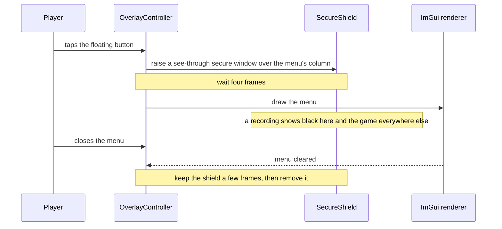

Showing the marks to the player while a recording shows the game alone would need a layer that screen capture leaves out, and an app has no public way to ask for one.

</details>

## Detection

The detector reads a square round the crosshair, between 1 and 1.75 times the model's input size (256 to 448 px for the standard model), copied out of the capture buffer inside the callback because the buffer is recycled the moment it returns. The newest frame wins, so what the pipeline reports is never older than one detection.

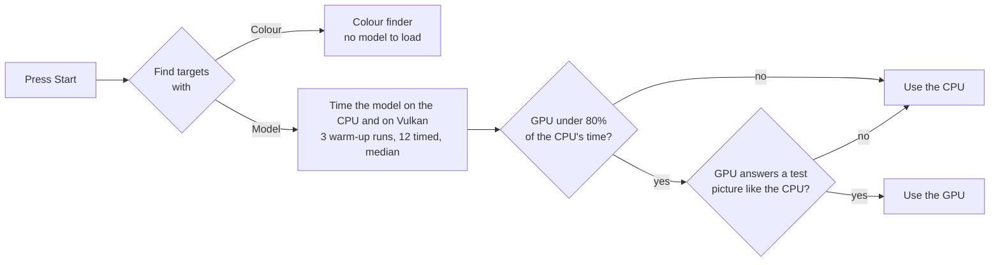

The GPU is shared with the game, so it has to be clearly faster. It also has to give the CPU's answer to a test picture (the sorted values of the two outputs within 5% of the CPU's range at 64 ranks, and none that is not a number), because a driver that is fast and wrong would leave the detector blind. While Android reports that the phone is warm, detection is limited to 30 runs a second, and to 15 when it is hot. `FrameThinner` keeps to that schedule by skipping frames, not by holding them back, so a frame that is detected is detected the moment it arrives.

<details>
<summary>Tracking: Kalman filters with two-pass matching</summary>

`Tracker` moves every target forward to the instant a frame was captured, pairs boxes with targets, refines each pair with a Kalman filter that smooths the box and measures its speed, and starts and retires targets. Pairing is done in the manner of ByteTrack: confident detections (0.40 and above) are matched first, by overlap or, for boxes that do not overlap, by distance in standard deviations of where the target is expected; weaker ones (0.12 to 0.40) then keep targets that would otherwise be lost. Two targets that overlap by 85% are the same target.

Speed is measured with the camera's own movement taken out: the camera slide between two frames comes from `CameraMotion`, is added to the prediction as a known shift, and widens the position uncertainty by a fraction of itself, so that a slide that is slightly wrong is corrected from the measurement and not read as the target running. The motion model is scaled by the box height, so a far target and a near one are treated alike. Each axis runs two filters side by side and blends them by how well each explains the boxes (an interacting multiple model filter): a steady one that smooths a target standing still or running straight, so its box does not wander, and an agile one that finds the new speed of a target that turns, stops or starts within a frame or two. A box much further off than even a sharp turn explains is trusted less the further off it is, so one box that belongs to something else cannot fling a target across the screen. In the simulated game, against a target strafing at 400 px/s and turning every half second, this took the aim's RMS error from 50.5 to 46.2 px at 60 detections a second and from 81.6 to 76.8 px at 15; a target running at 300 px/s with 15 detections a second had its head under the crosshair 36% of the time instead of 9% (`sh app/src/test/native/bench/run.sh follow`). On a still target the agile filter costs a little: in the simulated cameras below, the aim settles 0.02 to 0.04 s later at most camera gains and 0.10 s later with a 110 ms delay.

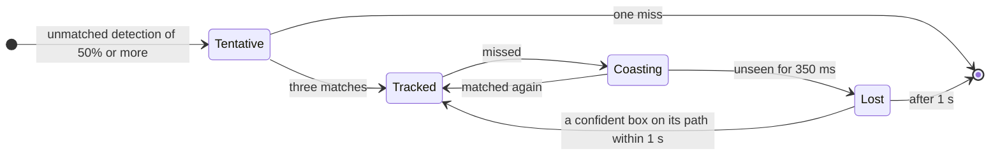

A tentative target is drawn and aimed at only if the detector is at least 90% sure of it, so a box reported for a single frame is never shown. A missed target is held at full strength for 120 ms and then fades. Both times stretch when results come slower than about 30 a second, so on a slow phone a target is not dropped between two results.

Targets go behind cover and come out again. A target missed in a frame or two keeps its pace, in the box drawn and in the aim; only past the hold time does its predicted speed fade, since it has probably stopped or gone behind something. When it is seen again, its speed is taken from how far it went while unseen, with the camera's turn taken out, so a runner that comes out from behind a wall is followed at its pace at once. A target forgotten after 350 ms is kept in mind for a second: a box of 50% or more on its path, anywhere from where it was last seen to where its speed would have taken it and within one box height of that line, is the same target, drawn at once under its old identity. In the simulated game, a runner at 300 px/s hidden for 0.3 s out of every 1.2 s had its head under the crosshair 70% of the time instead of 54% at 60 detections a second and 60% instead of 37% at 30, and the aim was back on its head 0.28 s after it came out instead of 0.41 s at 60 a second. Hidden for 0.6 s out of every 1.6 s, the aim lost it after 15% of the returns instead of 60% at 15 detections a second. A runner that stops behind the cover costs a little more than before: the aim is back on it 0.21 s after it shows instead of 0.11 s at 60 a second (`sh app/src/test/native/bench/run.sh cover`).

</details>

<details>
<summary>Detection with no model: colour</summary>

For games that draw an outline or a team colour round the players, the player can choose Colour instead of a model. In the in-game menu the player presses Learn colour and taps the colour inside the blue square. `learnColour` takes the most vivid colour in the 11 by 11 pixels round the tap (an outline is vivid, and what is behind it mostly is not) and keeps its hue, with how vivid and how bright it was as the least a pixel may be.

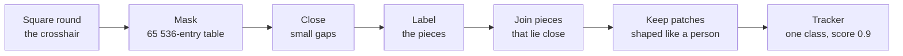

A table of 65 536 entries, filled once for each colour, turns a pixel of 5, 6 and 5 bits into yes or no. Small gaps in the mask are closed, so that a thin outline broken by the scenery stays one piece. The pieces are labelled, pieces that lie close together (the head and the body of one player) are joined, and a piece is kept when its size and shape could be a person. The finder allocates nothing once it has seen the picture's size. It finds a colour, not a person: the same colour in the scenery, on the game's buttons or on the player's own weapon is a target too, so the colour should be one the game uses for nothing but enemies. The overlay's own marks are in the picture the finder reads, so while a colour is looked for the overlay turns its own colours half way round the colour wheel when they are close to it.

</details>

## Touch helper

Android's input dispatcher follows one input device at a time in a window. When a second device starts a touch while the first has a finger down, the first one's moves are dropped. So the extra finger cannot come from a second virtual touchscreen next to the real one. The touch helper instead takes the real touchscreen over, passes every event it reports to one virtual copy of it, and adds the extra finger to that copy as an extra contact in the next free slot. The game sees one screen with the player's fingers plus one more.

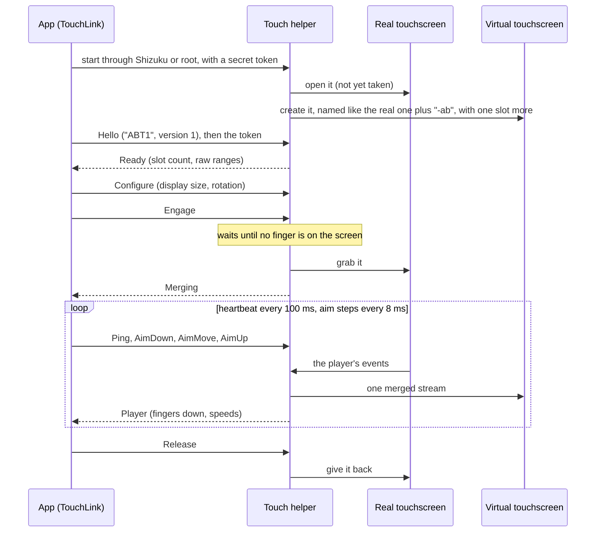

Everything that could leave the player without a working screen is guarded:

- The screen is taken over only when no finger is on it, and the app waits 700 ms after a takeover or a screen rotation before the first touch of the extra finger, because the system ignores a touch that begins sooner.
- The helper needs a heartbeat. If the app is silent for 700 ms the screen is given back at once, and after 5 s of silence the helper exits.
- Holding both volume keys for 1.5 s gives the screen back and stops the helper.
- If the helper is killed, the kernel gives the screen back by itself.

<details>
<summary>The merger, the protocol and the helper's states</summary>

`TouchMux` is the bookkeeping that merges the two sources. It reads events from the real screen, takes commands for the extra finger and writes one stream to a sink, and it performs no input or output, which is why it is tested on a computer. Contacts live in slots (multi-touch protocol B) and the extra finger gets the slot after the real ones. Three details are easy to get wrong:

- After the extra finger's events, the next slot-specific event from the real screen needs its slot selected again, because the real screen skips the selection when the slot is unchanged.
- `BTN_TOUCH` must be on while any contact is down, whoever's it is. Android treats contacts as hovering otherwise, so the button is derived and never copied.
- The extra finger's events must not cut into the middle of a group of events from the real screen, so they wait for its next `SYN_REPORT`, or for a resync when the kernel reported dropped events.

The app and the helper talk in fixed 16-byte packets over a loopback socket, so a reader never meets a message split across reads. The first two packets are a hello with the magic `ABT1` and the two halves of a 64-bit secret that the app generated with `SecureRandom` and passed on the helper's command line. The helper listens on 127.0.0.1 only, on a port it picks, serves one client and exits after five connections that fail the handshake. Sending never blocks: a message the helper cannot take is dropped, because the next one replaces it or the caller repeats it.

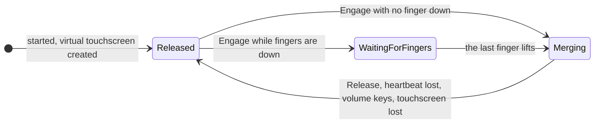

</details>

## Models and updates

The app carries no model: the APK is about 7 MB and a first run opens on the Models page, where AimBuddy General (9.2 MB) is one tap away. The store is a static `model/index.json` served from this repository, listing each model's files with their size and SHA-256. Every file is checked against those figures, a model replaces the old one only when it is complete, and a failed or cancelled download leaves the working model alone. A pair of `.param` and `.bin` files can be imported too, and is kept only if the detector can load it. See [model/README.md](model/README.md).

AimBuddy General 2 is made for phones first. It learned from Free Fire and PUBG Mobile footage and from four PC shooters, and it has a class for the player's own character, which the app leaves out. It reads the same 256 px square as version 1 and takes as long (8.1 ms a frame against 8.6 ms on a laptop processor, the two run in turn). It was judged on 602 views from Free Fire and PUBG Mobile videos it never saw, with 57 players in them counted by eye. At the default confidence it found 30 of the players, where version 1 found 13 and sunxds 17. It boxed the player's own character in none of the views, where version 1 did in 111, and it drew 6 boxes on things that are not people (a pylon, a distant car and a figure painted on a car), where version 1 drew 2. On the test pictures of four PC sets, which come from the same games it trained on, it found 86% of the players in CS:GO, 78% in Apex Legends, 97% in Halo Infinite and 68% in Far Cry 6, where version 1 found 18%, 5%, 0% and 58%. [docs/Training.md](docs/Training.md#aimbuddy-general-one-model-for-every-shooter) says how it is built and judged.

The app also reads the project's GitHub releases and offers a newer build of itself, and installs it only if it passes every check:

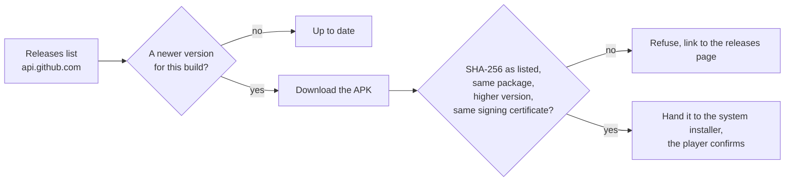

## Benchmarks

Three kinds of figure follow, and each says where it was measured. No phone has been benchmarked for this README: the performance readout (Settings, Overlay) and the Info tab of the in-game menu show the figures for yours, and [docs/Performance.md](docs/Performance.md) says how to read them.

### Per-frame steps on a computer

`sh app/src/test/native/bench/run.sh` builds the core with the Android build's optimisation flags (`-O3 -fno-math-errno -funroll-loops`) through `zig c++` 0.16.0 and times each step on one thread. These figures are from an Intel Core i5-12500H laptop, x86-64, so they show the work a step does and not how long a phone takes. Each figure is the middle of three runs of 200, median and 95th percentile; a median moved by up to 13% between the three runs and by up to 26% against a set taken on another day, so read them as sizes.

| Step | Median | 95th percentile |
|---|---:|---:|
| Colour finder, 256 px square, 3 people | 0.47 ms | 0.52 ms |
| Colour finder, 448 px square, 3 people | 1.2 ms | 1.4 ms |
| Decoding a model's output, 256 px, 3 classes | 4.8 µs | 5.3 µs |
| Camera look, 256 px square | 0.92 ms | 1.6 ms |
| Camera look, 448 px square | 1.0 ms | 1.4 ms |
| Tracker update, 6 detections | 1.3 µs | 1.5 µs |
| Tracker snapshot, 6 targets | 0.07 µs | 0.08 µs |
| Aim controller step, 3 targets | 0.43 µs | 0.52 µs |
| Touch merger, one report of a finger move and a move of the extra finger | 0.029 µs | 0.031 µs |
| Overlay fingerprint of 60 kB of draw data | 13 µs | 13 µs |

Apart from the detector, which depends on the model and the phone, the camera look is the one step that takes a noticeable share of a frame (16.7 ms at 60 Hz). It runs after the frame has been handed to the detector, and at most about 30 times a second. The tracker update costs about twice what it did with one filter per axis (0.57 µs), because each axis now runs two filters and mixes them. Within the detector, on this processor through NCNN's Python binding with three threads, running AimBuddy General 2 takes about 8 ms, turning the square into the model's input 0.3 to 0.6 ms, and decoding the output 5 µs, so the model is nearly all of it.

### Learning an unknown camera, in simulation

The aim controller runs against the simulated game that the tests use: a still target 260 to 280 px from the crosshair, a detector at 30 Hz with 2 px of noise, 10% dropouts and 15 ms of latency, and a camera measurement with 0.7 px of noise. The controller is told 1.5 px of slide per finger pixel and a 50 ms delay, and the simulated game uses the gain and delay in the first two columns. "Guess kept" is the same controller with Calibrate automatically off. Settling is the first moment the error stays under 8 px for good, within a run of 4 s, and overshoot is how far the aim went past the target. Each row is five runs with different detector noise: settling and what was learned are their averages, "2 of 5" says how many runs settled at all, and overshoot is the largest of the five. The runs are seeded, so `sh app/src/test/native/bench/run.sh camera` prints the same table every time.

| True gain | True delay | Settles, learning | Overshoot | Learned gain | Learned delay | Settles, guess kept | Overshoot |
|---:|---:|---:|---:|---:|---:|---:|---:|
| 0.4 | 50 ms | 1.00 s | 0 px | 0.40 | 53 ms | 3.36 s | 0 px |
| 0.6 | 50 ms | 0.88 s | 0 px | 0.60 | 53 ms | 1.99 s | 0 px |
| 1.5 | 50 ms | 0.75 s | 0 px | 1.52 | 53 ms | 0.63 s | 0 px |
| 2.5 | 50 ms | 0.74 s | 0 px | 2.53 | 52 ms | 0.55 s | 67 px |
| 4.0 | 50 ms | 0.72 s | 0 px | 4.05 | 52 ms | 0.96 s | 228 px |
| 6.0 | 50 ms | 0.70 s | 0 px | 6.05 | 52 ms | 1.53 s | 462 px |
| 8.0 | 50 ms | 0.69 s | 0 px | 8.01 | 52 ms | 2.10 s, 2 of 5 | 997 px |
| 12.0 | 50 ms | 0.62 s | 0 px | 11.97 | 52 ms | never | 1184 px |
| 4.0 | 15 ms | 0.60 s | 0 px | 3.94 | 17 ms | 0.36 s | 96 px |
| 4.0 | 30 ms | 0.61 s | 0 px | 4.00 | 33 ms | 0.51 s | 151 px |
| 4.0 | 80 ms | 0.65 s | 0 px | 3.91 | 84 ms | 1.84 s | 419 px |
| 4.0 | 110 ms | 0.87 s | 0 px | 3.85 | 115 ms | 2.69 s | 782 px |
| 4.0 | 150 ms | 0.71 s | 160 px | 3.96 | 155 ms | 3.91 s, 2 of 5 | 990 px |

With learning, the aim settles in 0.6 to 1.0 s across a 30-fold range of gains and a 10-fold range of delays, without overshoot up to a delay of 110 ms; at 150 ms the worst of the five runs overshoots by 160 px. The learned gain is within 4% of the true one and the learned delay is 2 to 5 ms above the true one. A controller that keeps its guess overshoots by 67 to 1184 px in every row where the real gain is 2.5 or more, settles in only 2 of 5 runs at a gain of 8 and never at 12, crawls (2.0 and 3.4 s) at gains of 0.6 and 0.4, and needs 1.8 to 3.9 s when the delay is 80 ms or more. When the guess happens to be right (gain 1.5, delay 50 ms) learning costs 0.12 s, because the first moves are small on purpose. This is a simulation: it shows the controller and the estimator doing what they are built to do, and not how any game behaves.

### Changes that were measured

Each change below was measured when it was made, and the figures are in the [changelog](CHANGELOG.md). The Android emulator runs the app's arm64 code through translation on a laptop, so its timings are not a phone's.

| Change | Measured on | Before | After |
|---|---|---|---|
| The camera look no longer runs ahead of the detector: age of a result, from its frame being on screen to its result being ready | Emulator, scripted scene, two runs each | 37.3 and 32.4 ms | 12.0 and 16.7 ms |
| The camera look is faster: mean and slowest of 778 recorded looks, fastest of seven passes | Desktop processor, looks recorded on the emulator | 0.84 and 4.0 ms | 0.61 and 2.2 ms |
| The overlay leaves out frames that look like the last one: threads of the app while AimBuddy runs over a still screen, two runs each | Emulator | 214% and 203% of a core | 46.6% and 2.6% |
| The colour finder, over a minute | Emulator | not applicable | 6.6 to 9.8 ms a frame, results 20 to 28 ms old when ready |

### Where the delay comes from

| Hop | What sets it |
|---|---|
| Screen to capture buffer | The system draws a second copy of the screen, at most 1600 px on the long edge, and delivers a frame only when the screen changes |
| Capture to detector | One copy of the square (at most 448 by 448 pixels, about 0.8 MB) and a hand-over through the mailbox. An unread frame is replaced, never queued |
| Detector | One run of the model on that square, the biggest cost. The readout shows it for the phone in hand |
| Tracker and aim | Microseconds (table above). The aim loop steps every 8 ms, so a result waits for the next step |
| Finger to game | One read, one merge (0.029 µs) and one write in the helper, then the game's own delay, which the controller learns |
| Marks | Drawn 20 ms ahead of now, so they land on the target and not behind it |

## Install

1. Download `AimBuddy-v<version>.apk` from [Releases](https://github.com/1337Xcode/AimBuddy/releases) and open it. The `-debug` file beside it is a debuggable build for testing and bug reports; you do not need it. The app installs over 0.3.0-beta.2 and later without uninstalling. If Android says the package conflicts with an existing one, uninstall the old copy once and install again, see [Troubleshooting](docs/Troubleshooting.md).
2. Open AimBuddy. It opens on the Models page: tap Get on AimBuddy General, or import a model of your own. The app carries no model, so this comes first.
3. When it asks, allow display over other apps, notifications and screen capture.
4. To let AimBuddy steer the camera, give it touch access with [Shizuku](docs/ShizukuSetup.md) (no root needed) or with root, and check it with Test touch access on the Touch access screen. Without either, AimBuddy still outlines people.
5. Press Start, then switch to your game. Switch steering on from the second tab of the in-game menu once you are in the game.

Releases before 0.3.5-beta.1 cannot update themselves, so install that one by hand; later ones arrive in the app.

## Build and test

You need JDK 17, the Android SDK 35 with build tools 36, NDK 29.0.13113456 and CMake 3.22.1.

```sh
./gradlew assembleDebug                 # app/build/outputs/apk/debug/app-debug.apk
./gradlew testDebugUnitTest             # Kotlin tests
sh app/src/test/native/run.sh           # C++ core tests, with a C++17 compiler on the path
sh app/src/test/native/bench/run.sh     # the benchmarks above
```

- `app/src/test/native` holds C++ tests of the parts that perform no input or output: the tracker, camera motion, the touch merger, the detector's decoding, the colour finder, the menu's drag scroller, the overlay's fingerprint and the settings. The aim controller is run against a simulated game with a known camera gain and delay, and has to settle for gains and delays it was not told.
- `app/src/test/java` holds Kotlin tests of the update logic, the model store (downloads, cancelling, failures), the touch access checks and the thermal limits.
- `training/tests` holds tests of the training pipeline's dataset split and of the labelling rules of the universal model's pipeline (`training/universal`).
- Debug builds include a stand-in first-person game with a known camera response, used to run the whole loop on an emulator.

Each build generates its own launcher icon from a random seed; `-Paimbuddy.iconSeed=<number>` repeats one. Releases are described in [docs/Releasing.md](docs/Releasing.md).

## Documentation

| Document | Contents |
|----------|----------|
| [Architecture](docs/Architecture.md) | How the app is put together, from capture to touch |
| [Settings guide](docs/SettingsGuide.md) | Every setting and what it does |
| [Shizuku setup](docs/ShizukuSetup.md) | Touch access without root |
| [Performance](docs/Performance.md) | What costs time, and how to read the numbers |
| [Training](docs/Training.md) | Training a detector for your game |
| [Troubleshooting](docs/Troubleshooting.md) | When something does not work |
| [Releasing](docs/Releasing.md) | Building, signing and publishing, and how updates reach players |
| [Model store](model/README.md) | How models are published and installed |
| [Changelog](CHANGELOG.md) | What changed in each release |
| [Contributing](CONTRIBUTING.md) | Standards and the pull request process |

## Credits

[NCNN](https://github.com/Tencent/ncnn) runs the model and [Dear ImGui](https://github.com/ocornut/imgui) draws the in-game menu. [Shizuku](https://github.com/RikkaApps/Shizuku) provides touch access without root. The app is built with Jetpack Compose and the Geist font. The detection models are made with [Ultralytics](https://github.com/ultralytics/ultralytics) YOLO. AimBuddy General learned from video labelled by sunxds, a model from [sunone_aimbot](https://github.com/SunOner/sunone_aimbot) by SunOner, and from the CS:GO, Apex Legends, Halo Infinite and Far Cry 6 sets of [Roboflow 100](https://universe.roboflow.com/roboflow-100) (CC BY 4.0); [docs/Training.md](docs/Training.md#aimbuddy-general-one-model-for-every-shooter) lists every source. The full list, with licenses, is under Settings, About, Open source notices.

## License

AimBuddy is released under the AimBuddy Community Free Use License v1.0. In short: use it, change it and share it freely; do not sell it; anything you build from it stays free under the same terms and says "Based on AimBuddy" with a link here. See [LICENSE](LICENSE) for the full terms.

AimBuddy General, the detection model the store offers, is trained with Ultralytics YOLO26 and is licensed under AGPL-3.0.

## Legal notice

AimBuddy helps with aiming. Use it only where local law, the game's rules and the platform's terms allow it. Some games forbid help with aiming in online play, and using it there can get an account banned. You are responsible for how you use it.
