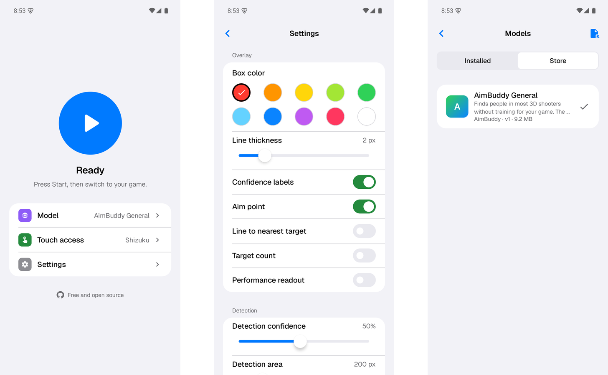

# AimBuddy

Aim assist and enemy highlights for mobile shooters, for players who find fast aiming hard. AimBuddy watches the game screen, outlines the enemies it finds, and, if you allow it, adds a second finger that steers your view onto the one nearest your crosshair. It runs on modest phones, it never touches the game's files or memory, and it is free.



## What it does

- **Highlights enemies.** A detection model finds people on screen and a thin outline follows each one. Color, thickness and labels are yours to set, and the outline stays visible for any kind of color vision.
- **Helps you aim.** The assist puts one extra finger on the touchscreen, away from your own, and moves your view towards the target nearest the crosshair, at the part of the body you pick. It measures how your game's camera answers a finger while you play, so it needs no setup per game.
- **Stays out of the way.** Your own fingers keep working as they always do. Holding both volume keys, or the stop button in the notification, gives the touchscreen back at once.
- **Fits the phone.** Detection runs on a small crop around the crosshair, on the CPU or the GPU, whichever is faster on your phone. It eases off when the phone reports that it is getting hot.
- **Streamer mode.** Draws nothing over the game and keeps its menu out of screenshots and recordings.
- **Updates itself.** The app checks GitHub for a new release and for new models, so nobody has to reinstall by hand.
- **Three languages.** English, Chinese and Russian.

## Install

1. Download the latest APK from [Releases](https://github.com/1337Xcode/AimBuddy/releases) and open it.
2. Open AimBuddy. When it asks, allow display over other apps, notifications and screen capture.
3. For aim assist, give AimBuddy touch access with [Shizuku](docs/ShizukuSetup.md) (no root needed) or with root. Without either, AimBuddy still highlights enemies.
4. Press Start, then switch to your game.

AimBuddy needs Android 11 or newer on an arm64 phone. The first release that can update itself has to be installed by hand once; after that updates arrive in the app.

## Models

AimBuddy General, a detector for people in 3D games, comes inside the app, so the first run needs no connection. The Models screen also lists the models published in the [`model`](model/README.md) folder, installs them with a tap and tells you when a newer version exists. You can import your own model from two files, and [train one for your game](docs/Training.md).

## Build from source

You need JDK 17, the Android SDK 35 with build tools 36, NDK 29.0.13113456 and CMake 3.22.1.

```sh
./gradlew assembleDebug          # app/build/outputs/apk/debug/app-debug.apk
./gradlew testDebugUnitTest      # Kotlin tests
sh app/src/test/native/run.sh    # C++ core tests, with a C++17 compiler on the path
```

Each build draws its own launcher icon, a screen of TV static. Pass `-Paimbuddy.iconSeed=<number>` to get the same one again. Releases are described in [docs/Releasing.md](docs/Releasing.md).

## Documentation

| Document | Contents |
|----------|----------|
| [Architecture](docs/Architecture.md) | How the app is put together, from capture to touch |
| [Settings guide](docs/SettingsGuide.md) | Every setting and what it does |
| [Shizuku setup](docs/ShizukuSetup.md) | Touch access without root |
| [Performance](docs/Performance.md) | What costs time, and how to read the numbers |
| [Training](docs/Training.md) | Training a model for your game |
| [Troubleshooting](docs/Troubleshooting.md) | When something does not work |
| [Releasing](docs/Releasing.md) | Building, signing and publishing, and how updates reach players |
| [Model store](model/README.md) | Adding a model to the store |
| [Changelog](CHANGELOG.md) | What changed in each release |
| [Contributing](CONTRIBUTING.md) | Standards and the pull request process |

## Credits

[NCNN](https://github.com/Tencent/ncnn) runs the model and [Dear ImGui](https://github.com/ocornut/imgui) draws the in-game menu. [Shizuku](https://github.com/RikkaApps/Shizuku) provides touch access without root. The app is built with Jetpack Compose and the Geist font. The detection models are made with [Ultralytics](https://github.com/ultralytics/ultralytics) YOLO. The full list, with licenses, is under Settings, About, Open source notices.

## License

AimBuddy is released under the AimBuddy Community Free Use License v1.0. In short: use it, change it and share it freely; do not sell it; anything you build from it stays free under the same terms and says "Based on AimBuddy" with a link here. See [LICENSE](LICENSE) for the full terms.

The YOLO26 detector that comes with the app is made by Ultralytics and is licensed under AGPL-3.0.

## Legal notice

Use AimBuddy only where local law, the game's rules and the platform's terms allow it. Some games forbid aim assistance in online play, and using it there can get an account banned. You are responsible for how you use it.
