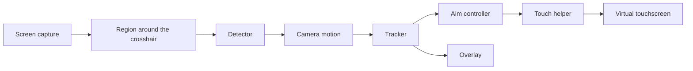

# Architecture

How AimBuddy is put together: what runs where, how a frame becomes a touch, and where to change things.

## Parts

AimBuddy is three programs that work together.

| Part | Language | What it does |
|------|----------|--------------|
| The app | Kotlin, Jetpack Compose | The screens, the permission dialogs, the foreground service that runs the assist, screen capture, and the overlay windows |
| The native library `libesp_native.so` | C++ | Detection, tracking, the aim controller, the overlay's drawing, and the settings |
| The touch helper `libaimtouch.so` | C++ | A small program that reads the real touchscreen and adds the assist's finger to it. It runs with the privilege of Shizuku (shell user) or root |

The app and the native library share a process. The helper is a separate process, started by the app, and the two talk over a loopback socket.

## From the screen to a touch

1. **Capture.** `CaptureSession` mirrors the display with MediaProjection into an `ImageReader`. Each frame goes to `RoiCapture`, which copies out only the square region the detector needs (set by the "Detection area" setting) and publishes it. The mailbox keeps one frame, the newest, so a slow phone drops frames instead of falling behind.
2. **Detect.** `DetectionPipeline` runs on its own thread. `YoloDetector` runs an NCNN model on the region. At start it times the model on the CPU and on the GPU (Vulkan) and keeps the faster one, because the GPU is shared with the game. What each class of the model means comes from the model's `model.json` (see `ModelProfile`). While the phone reports that it is warm or hot, `ThermalGovernor` asks the pipeline for fewer detections a second, and `FrameThinner` skips the frames over that limit.
3. **Measure the camera.** `DetectionPipeline` hands every captured frame to `GlobalMotion` on the capture thread, at most 30 times a second, whether or not the detector looks at it. A box found in a frame is drawn well over a tenth of a second later, and the camera has to be known up to that moment, not only up to the picture the box was found in. `GlobalMotion` reduces both frames to 64 by 64 grey values and finds how far the whole picture slid by phase correlation, leaving out the targets being followed, the game's fixed interface and AimBuddy's own boxes. The result goes into `CameraMotion`, which also carries the player's own turn a little past the newest frame (fading out, and not while the assist's own finger is moving, because then it cannot tell whose slide it was).
4. **Track.** `Tracker` pairs the boxes with the targets it already follows (strong detections first, then weaker ones, in the manner of ByteTrack), smooths each target with a Kalman filter and measures its speed, free of the camera's own movement. A new target is drawn and aimed at from its third sighting on, or at once when the detector is at least 90 percent sure, so a box the detector reports for a single frame is never shown. A target that looks to be standing still is smoothed harder than one that is clearly moving, and only the part of a speed the filter is sure of is carried forward to draw the box. A target that goes unseen for a few frames keeps moving along its path, so a box never blinks because of one missed detection.
5. **Aim.** `AimLoop` runs `AimController` at a steady rate. The controller picks a target (nearest the crosshair, biggest, or most certain), predicts where it will be when this step's move takes effect, and decides how far to drag the extra finger. Each move is recorded in `CameraMotion`, so the next frames are judged knowing what the assist itself did. A target that stays put on the screen, away from the crosshair, while the camera sweeps a good way past it (the player's own weapon or character, which a detector sometimes takes for an enemy) can never be reached, so the controller gives up on it for a few seconds, longer each time it happens in the same place. The overlay stops drawing such a box too, for as long as the controller remembers it, so a gun does not stay outlined as a person.
6. **Touch.** `TouchLink` sends the move to the helper. The helper writes it to a virtual touchscreen next to the player's own fingers.
7. **Draw.** The overlay reads the tracker's targets on every frame and draws them. It draws a little ahead of now, so a box lands where the target will be when the frame reaches the glass.

## The camera is unknown, and the controller knows it

How far a game's view turns per finger pixel, and how long it takes to react, differ between games and sensitivity settings by a factor of ten or more. A controller that guesses wrong overshoots and swings. So:

- `CameraMotion` keeps a log of the assist's finger moves and of the slides measured on the frames, and answers "how far did the scene slide between these two instants", for the past from measurements and for the near future from the moves that are on their way.
- `ResponseEstimator` fits the camera's gain and delay from that log by least squares. Ordinary aiming is the experiment; nothing is asked of the player. While the player turns the camera by hand too, the assist's finger mostly reacts to that turning and a straight fit of slide on finger travel misses both figures, so the estimator also fits how the slide and the finger travel change from one measurement to the next, which drops a smooth turn out, and uses that fit while the straight one cannot pin the delay down. The last result is saved and used as a starting guess the next time, never as a fact.
- While the picture cannot be read (a bare sky, a scene too busy to compare), the controller allows less finger travel and closes the gap more slowly.
- If the finger moves a good way and the scene does not slide with it (the touch started while the screen was turning, or landed where the game does not look around), the finger is lifted and put down again, waiting a little longer each time.
- If the aim swings anyway, a stability factor takes its strength down until it stops.

## The touch helper

Android's input dispatcher follows one input device at a time in a window. When a second device starts a touch while the first has a finger down, the first one's moves are dropped. So the assist cannot be a second touchscreen next to the real one. The helper instead takes the real touchscreen over, passes every event it reports to one virtual copy of it, and adds the assist's finger to that copy as an extra contact in the next free slot. The game sees one screen with the player's fingers plus one more.

Everything that could leave the player without a working screen is guarded:

- The screen is only taken over when no finger is on it, and the app waits 700 ms after a takeover or a screen rotation before the first assist touch, because the system ignores a touch that begins sooner.
- The helper needs a heartbeat from the app. If it stops, the screen is given back at once.
- Holding both volume keys gives the screen back and stops the helper.
- If the helper is killed, the kernel gives the screen back by itself.

`TouchHelper` starts the helper through Shizuku (`HelperHost`, a Shizuku user service) or through root (`HelperProcess`, with `RootShell`). Automatic prefers Shizuku. The helper picks its own port and prints it, and the app sends a secret with its first message, so the app never talks to a program that is not the helper.

`TouchMux` is the bookkeeping that merges the two sources. It does no input or output itself, so it is tested on a computer.

## The overlay

The overlay is two windows added with `WindowManager`, managed by `OverlayController`:

- A full screen window with an `OverlayView`, a `TextureView` in which the native code draws the targets and the settings menu with ImGui on a thread of its own. It lets every touch through to the game, except while the menu is open.
- The floating button, a `StaticBubbleView`. Tapping it opens the menu, dragging moves it, holding it stops AimBuddy.

The overlay is part of the screen the app captures, so the detector sees the marks the app draws on its own targets. That matters: on five frames of a free shooter (Xonotic), a full outline close to a target moved the model's confidence in it by 0.28 on average and made it lose one target in five, about twice as much as shifting the picture by a pixel does. Corner brackets a good way off the target moved it by 0.09 to 0.13 and lost none, so that is how targets are marked. The sample is small (ten boxes) and was measured offline with the app's own model, not on a phone in a match. A debug build can write the picture the detector reads (the playground's `dumpMs` extra writes `frame.ppm`), which is how the overlay's presence in it was confirmed.

From Android 12 the system drops every touch that goes through another app's overlay when the overlay is more opaque than 0.8. A `SurfaceView` is judged by a rule that ignores how transparent its pixels are, which is why the overlay is a `TextureView`, and the window's alpha is kept just under the limit while it is see-through. The window only becomes opaque and takes touches while the menu is open, and if the menu is open but nothing is being drawn, it stops taking touches after a short while, so a broken renderer cannot leave an invisible layer over the screen.

### Streamer mode

A window marked `FLAG_SECURE` is drawn as solid black in any capture that is not secure, however transparent its pixels are. AimBuddy's own picture of the screen is such a capture. A secure full screen window would therefore black out the game for the recorder and for the detector alike, so streamer mode does something else: the native code draws nothing over the game and the floating button turns invisible. The button stays where it is and keeps working (a tap opens the menu, holding it stops AimBuddy), so the player is never locked out, and the notification has a Menu button as well. The notification's status bar icon is empty, because the system does not let a foreground service's notification out of the status bar. The full screen window is secure only while the menu or the touch area editor is open, which is a few moments in which a recording shows black. `OverlayController` makes the window secure before the menu is drawn into it, and after the menu is cleared it keeps the window secure for a few more frames before giving the touches back, so the menu stays out of the recording.

## Models

`ModelCatalog` keeps the list of models on the phone and which one is in use. The app carries no model of its own: the detector loads the two files of the one in use, and a phone with none cannot start the assist. A first run therefore opens on the models page, where a guide says how to get one, and Start on a phone with no model leads there too. A model is of one of two kinds:

- **From the store.** `ModelStoreRepository` reads `model/index.json` from the `master` branch (one small request), lists the models, and installs the one the player picks into `files/models/<id>/`. AimBuddy General, the default, is listed there like any other. Every file is checked against the size and SHA-256 in the index, and a model is swapped in only once it is complete, so a failed download never damages a model that works.
- **Imported.** The player picks a `.param` and a `.bin` file.

The store's format and how to add a model are in [model/README.md](../model/README.md).

## Updates

The `update` package keeps the app current. `ReleaseFeed` reads GitHub's list of releases and picks the newest one that is newer than the installed version, `AppUpdater` downloads it and checks the SHA-256, the package name, the version and the signing certificate, and hands it to the system's installer with `PackageInstaller`. The player confirms in the system's dialog. After the system has replaced the app, `AppUpdatedReceiver` opens it again. See [Releasing](Releasing.md).

## Settings

`SettingsStore` in the native library is the one place the settings live. The file, `settings.cfg` in the app's private storage, has one `name=value` line per setting. Readers ignore names they do not know and keep the default for names that are missing, so a file written by another version still loads. The Compose screens read and write it through `NativeBridge`, and the ImGui menu in the game reads and writes the same store, so a change in either shows in both. Values are clamped when they are stored, so no other code checks ranges.

## Threads

| Thread | Work |
|--------|------|
| Main | The screens, the overlay windows, the permission dialogs |
| Capture handler | `ImageReader` callbacks; copies the region out of each frame |
| Detection pipeline (native) | Detector, camera motion, tracker |
| Aim loop (native) | The aim controller at a steady rate; the connection to the helper |
| Overlay render (native, ImGui) | Targets and menu, at most 60 frames a second (90 while the menu is open) |
| Assist start | Loads the model and starts the helper, off the main thread |

The tracker is shared by the pipeline thread, the aim loop and the overlay, and hands out snapshots under its own lock. `CameraMotion` is safe to use from several threads.

## Testing

- `app/src/test/native` holds the C++ tests of the parts that do no input or output: the tracker, the aim controller against a simulated game with a known camera response, camera motion, the touch merger, the detector's decoding, and the settings. Run them with `sh app/src/test/native/run.sh`.
- `app/src/test/java` holds the Kotlin tests of the update logic, the model store and model files, the touch hints on the Home screen and the thermal limits: `./gradlew testDebugUnitTest`.
- Debug builds contain a playground (`app/src/debug`), a stand-in first-person game with a known camera gain and delay, and a few hooks into the native code that record traces. They are compiled in only for debug builds (`AIMBUDDY_DEBUG_HOOKS`).

## Where to change things

| To change | Look at |
|-----------|---------|
| The screens | `app/src/main/java/com/aimbuddy/ui/` |
| The start flow and permission dialogs | `MainActivity.kt` |
| What runs while the assist is on | `AssistService.kt` |
| Screen capture | `CaptureSession.kt`, `capture/roi_capture.*` |
| Detection and the models | `detector/`, `core/detection_decoder.*`, `core/model_profile.h` |
| Easing off when the phone is hot | `ThermalGovernor.kt`, `core/frame_thinner.h` |
| How the picture's motion is measured | `core/global_motion.*`, `core/camera_motion.*`, `core/response_estimator.*` |
| Following targets | `core/tracker.*` |
| How the aim moves | `core/aim_controller.*`, `pipeline/aim_loop.*` |
| The touchscreen | `touch/`, `core/touch_mux.*` |
| The overlay and the in-game menu | `OverlayController.kt`, `renderer/imgui_menu.cpp`, `overlay/target_overlay.*` |
| The settings and their limits | `settings/settings.h`, `settings/settings_store.cpp` |
| The model store | `ModelStoreRepository.kt`, `model/index.py` |
| Updates | `update/` |
