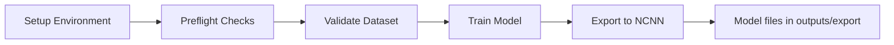
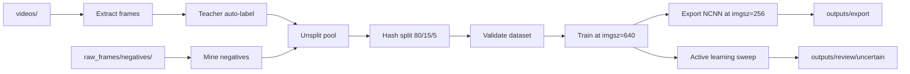
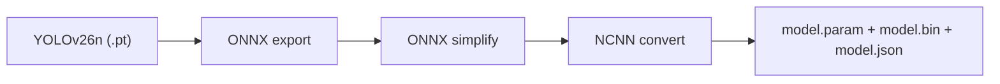

# Training Guide

How to train a YOLOv26n model for your game and bring it into AimBuddy using the bundled training pipeline.

## Model Contract

The pipeline trains a single-class YOLOv26n model (class 0 = enemy) and exports it for the NCNN runtime as three files:

| File | Purpose |
|------|---------|
| `model.param` | NCNN model graph definition |
| `model.bin` | NCNN model weights |
| `model.json` | What the model is and how to read its output (see [model/README.md](../model/README.md)) |

The network input is `runtime_imgsz` pixels (256 by default). The app reads the input size and the classes from the model itself, so a model trained with other settings works as long as its files are valid NCNN.

## Environment Requirements

| Item | Minimum | Recommended |
|------|---------|-------------|
| OS | Windows 10 or 11 (64-bit) | Windows 11 |
| Python | 3.10 to 3.12 | 3.11 |
| CPU | 4 cores | 8+ cores |
| RAM | 8 GB | 16 GB+ |
| Free disk | 15 GB | 30 GB+ |
| GPU | CPU-only supported | NVIDIA GPU with CUDA 12.1 |

## Pipeline Overview

The legacy `07_run_full_pipeline.bat` covers the classic train + export flow:



For the fully automated path (`00_automate.bat`), the pipeline is:



State is checkpointed after each step to `outputs/reports/automate_state.json`. Re-running picks up at the first failed or unfinished step.

### One-Command Run

```powershell
cd training
scripts\00_automate.bat
```

This runs the full automated pipeline above. Use `scripts\07_run_full_pipeline.bat` instead if you already have a hand-curated dataset and just want the classic train + export.

### Full Pipeline Flags

`scripts\07_run_full_pipeline.bat` forwards flags to `src/run_pipeline.py`:

| Flag | Purpose |
|------|---------|
| `--manual` | Force manual training config from `config.ini` |
| `--adaptive` | Force adaptive hyperparameter selection |
| `--skip-export` | Stop after training (skip NCNN export) |
| `--non-strict-preflight` | Warn on minimum hardware failures instead of stopping |
| `--config <path>` | Use a custom config file |

Example:

```powershell
scripts\07_run_full_pipeline.bat --manual --skip-export
```

## Step-by-Step Scripts

Run from the `training/` directory:

| Script | Purpose |
|--------|---------|
| `scripts\01_setup_environment.bat` | Create virtual environment, install dependencies |
| `scripts\02_extract_frames.bat` | Extract video frames for labeling (optional) |
| `scripts\03_validate_dataset.bat` | Verify dataset structure and label format |
| `scripts\04_train_adaptive.bat` | Train with auto-selected hyperparameters |
| `scripts\05_train_manual.bat` | Train with explicit config from `training/config/config.ini` |
| `scripts\06_export_ncnn.bat` | Convert trained weights to NCNN format |
| `scripts\07_run_full_pipeline.bat` | Run all steps end-to-end |
| `scripts\08_auto_label.bat` | Use a large teacher model to label frames automatically |
| `scripts\09_mine_negatives.bat` | Add empty-label samples (menus, vehicles, NPCs) to suppress false positives |
| `scripts\10_active_learning.bat` | After first training, surface unlabeled frames most worth labelling next |

### Preflight Strictness Modes

- `scripts\01_setup_environment.bat` runs preflight with `--non-strict`.
- `scripts\04_train_adaptive.bat` and `scripts\05_train_manual.bat` run strict preflight.
- `scripts\07_run_full_pipeline.bat` runs strict preflight by default, and supports `--non-strict-preflight`.

If strict mode blocks your hardware, run the full pipeline with `--non-strict-preflight` and review the generated report warnings.

### Frame Extraction Details

`scripts\02_extract_frames.bat` uses runtime-aligned preprocessing:

- Resizes input video to 720p height.
- Applies center crop (`--crop`, default `480`).
- Resizes to `imgsz` from config (default `256`).
- Extracts at `--fps` frames per second (default `1.0`).

Output path:

```text
training/raw_frames/<video_name>/
```

## Dataset Structure

Required layout:

```
training/dataset/
    data.yaml
    train/
        images/
        labels/
    valid/
        images/
        labels/
    test/
        images/
        labels/
```

### Label Format

YOLO format, one `.txt` file per image:

```
class_id x_center y_center width height
```

Rules:
- All coordinates normalized to [0, 1].
- Class ID must be `0` (single class: enemy).
- No data leakage between train, valid, and test splits.
- Include background-only images (empty label files) to reduce false positives.

## Skipping Manual Labelling

Hand-drawing boxes on thousands of frames is the worst part of training. The new auto-label pipeline replaces ~95% of that work with a large teacher model.

### Stage 1 - Bootstrap dataset with a teacher

```powershell
scripts\08_auto_label.bat
```

This script:

1. Loads (and auto-downloads on first run) a large COCO-pretrained YOLO - `yolov8x.pt` by default, ~135 MB. The teacher detects the `person` class with very high recall.
2. Walks every image in `raw_frames/` at `imgsz=1280` so small/distant humans are still found (the runtime model at `imgsz=256` would miss them).
3. Filters detections by confidence (`--conf 0.30` default), runs NMS, drops boxes that are absurdly tiny or huge (UI noise vs HUD overlays).
4. Remaps the COCO person id to our enemy id (0) and writes YOLO labels into `dataset/train/labels/`.

You should still spot-check the output - the teacher occasionally boxes posters, billboards, vehicles, or friendly NPCs. Open `dataset/train/` in Roboflow / labelImg / CVAT and delete obvious mislabels. That review takes minutes instead of hours.

Tune for harder targets:

```powershell
scripts\08_auto_label.bat --teacher yolo11x.pt --imgsz 1536 --conf 0.20
```

After your first training pass, swap the teacher to your trained `best.pt` and run again at `imgsz=640`. The student now distills its own labels on fresh frames - this is how to grow the dataset without ever opening a labelling tool again.

#### A model made for your game as the teacher

A general person detector knows nothing about your game: it boxes your own weapon and arms with more confidence than a distant enemy (on five frames of a free shooter, the model that ships with AimBuddy scored a weapon at 0.70, higher than most of the enemies in the same frames). A model made for the game knows what its enemies look like. The community models of the [Aimmy V2](https://github.com/Babyhamsta/Aimmy) repository are YOLOv8 detectors exported to ONNX, one game each. Download the one for your game from that repository yourself, for your own use (check its terms before sharing anything made with it), and give it to the labeller:

```powershell
scripts\08_auto_label.bat --teacher-onnx "C:\path\to\Your Game.onnx" --conf 0.40 --write-negatives
```

Those models read a square of the screen at the pixel size they were trained on, usually 640 by 640, so the script cuts each frame into overlapping tiles of that size and keeps a box seen in two tiles once. If your recordings are bigger or smaller than the game was when the model was made, resize them first with `--onnx-scale`, for example `--onnx-scale 0.67` for 1080p recordings of a model made on 720p. `--write-negatives` keeps the frames the teacher found nobody in, so the student also learns what is not an enemy, your own weapon included. Then train as usual: the student (`yolo26n`, 256 pixels at run time) is small enough for a phone, which a 640 pixel YOLOv8 is not (roughly nine times the work per picture).

### Stage 2 - Add labelled negatives

A detector trained only on positives over-confidently boxes every human-shaped thing - kill-feed avatars, billboard models, friendly NPCs, vehicles. Mix in 10-25% negatives:

1. Drop no-enemy frames into `raw_frames/negatives/` (menus, scoreboards, vehicles, allies, etc.).
2. Run `scripts\09_mine_negatives.bat`.

This copies them into `dataset/train/` with empty label files. The model learns what is NOT a target and stops firing on HUD elements.

### Stage 3 - Active learning

After the first training pass, surface frames the model is unsure about:

```powershell
scripts\10_active_learning.bat
```

This script runs your trained student over a fresh `raw_frames/` pool, scores each frame by:

- Number of student detections in the uncertain confidence band (0.25-0.55).
- Disagreement with a larger teacher (student misses N boxes the teacher catches).
- Zero-detection frames where the teacher fires (strongest signal - your model has a blind spot here).

The top-scoring frames are copied to `outputs/review/uncertain/`. Hand-label just those, add them back to `dataset/train/`, retrain. Each iteration squeezes more accuracy out of the smallest possible manual effort.

### Recommended Dataset Composition

| Source | Share | Purpose |
|--------|-------|---------|
| Auto-labelled gameplay frames | 60-75% | Variety: maps, outfits, poses, distances |
| Hand-corrected active-learning surfaces | 10-20% | Model's known blind spots |
| Hand-labelled negatives (menus, vehicles, NPCs) | 10-25% | Suppresses false positives |
| Hand-labelled hard cases (distant, occluded, prone) | 5-15% | Pushes the long tail |

### High-resolution training, low-resolution inference

The training config now trains at `imgsz=640` (config `[training] imgsz`) and exports the NCNN model at `runtime_imgsz=256` (config `[training] runtime_imgsz`). Training at the higher resolution lets the network learn small / distant targets that disappear at 256x256; the exported model still runs at 256 on device so latency on the phone is unchanged.

### data.yaml Example

```yaml
train: train/images
val: valid/images
test: test/images
nc: 1
names: ['enemy']
```

## Training Modes

### Adaptive Training

Auto-selects hyperparameters based on dataset size:

```powershell
scripts\04_train_adaptive.bat
```

Good for first-time training or when unsure about settings.

Adaptive thresholds:

| Dataset size (train images) | Typical resolved behavior |
|-----------------------------|---------------------------|
| `< 300` | epochs around 260, batch constrained to 8-12, higher patience |
| `300 to < 1200` | epochs around 180, batch constrained to 12-20 |
| `>= 1200` | epochs around 120, batch constrained to 16-32, lower patience |

### Manual Training

Uses explicit values from `training/config/config.ini`:

```powershell
scripts\05_train_manual.bat
```

Use this when you need specific epoch counts, batch sizes, or augmentation settings.

### Resolved Configuration

The final configuration used for training is saved to:

```
training/outputs/reports/selected_training_config.json
```

## NCNN Export

```powershell
scripts\06_export_ncnn.bat
```

Export flow:



The export writes its files to `training/outputs/export/` and leaves the app alone. An existing `model.json` keeps what you wrote in it, except `inputSize`, which follows the export.

### Using the model

- **On your own phone.** Copy `model.param` and `model.bin` to the phone and pick them in the app under Models, Import.
- **For everyone.** Put the three files in a folder `model/<id>/`, fill in the title, description and author in `model.json`, raise its `version` whenever the files change, run `python model/index.py` and open a pull request. [model/README.md](../model/README.md) has the details. The weights must be yours to share under a license the project can redistribute.

Path format note:
- Configuration paths intentionally use forward slashes (`/`) for cross-platform behavior, including on Windows.

## Output Locations

| Output | Path |
|--------|------|
| Training reports | `training/outputs/reports/` |
| Trained weights | `training/outputs/runs/detect/train/weights/` |
| Model files (`model.param`, `model.bin`, `model.json`) | `training/outputs/export/` |

## Preflight Checks

The preflight script validates:

- Python version (3.10 to 3.12)
- CPU core count and available memory
- Disk space
- CUDA availability (warning if not found, training proceeds on CPU)

Results saved to: `training/outputs/reports/preflight_report.json`

GPU status values in `preflight_report.json`:

| gpu_status | Meaning |
|------------|---------|
| `cuda_ready` | CUDA torch stack available and usable |
| `torch_cuda_unavailable` | NVIDIA GPU exists but torch CUDA is unavailable |
| `torch_missing_or_incompatible` | torch import/runtime issue in current environment |
| `no_gpu` | No NVIDIA GPU detected |

## Report Files

| File | Contents |
|------|----------|
| `preflight_report.json` | Environment validation results |
| `dataset_report.json` | Dataset statistics and validation |
| `selected_training_config.json` | Resolved training hyperparameters |
| `pipeline_last_run.json` | Pipeline step status and timings |
| `pipeline_last_run.log` | Full pipeline stdout/stderr |

### Model Contract Validation

Before exporting custom checkpoints, verify single-class runtime compatibility:

```powershell
cd training
python src\check_model_contract.py --weights outputs\runs\detect\train\weights\best.pt
```

## Common Issues

| Problem | Solution |
|---------|----------|
| CUDA not detected by torch | Install CUDA 12.1, reinstall torch with CUDA wheel |
| Dataset validation fails | Fix label format, check normalized coordinates |
| Export succeeds but app does not detect | Import the files under Models, Import. If Start says the detection model could not be loaded, the two files are not from the same export |
| Base model download fails during setup | Manually place `yolo26n.pt` in `training/` root, rerun setup |
| Training is very slow | Use NVIDIA GPU, or reduce dataset size for faster iterations |
| Out of memory during training | Reduce batch size in `config.ini`, or use adaptive mode |

For script-level folder details, see [training/README.md](../training/README.md).

## Related Documentation

- [Architecture](Architecture.md)
- [Settings Guide](SettingsGuide.md)
- [Performance](Performance.md)
- [Troubleshooting](Troubleshooting.md)
